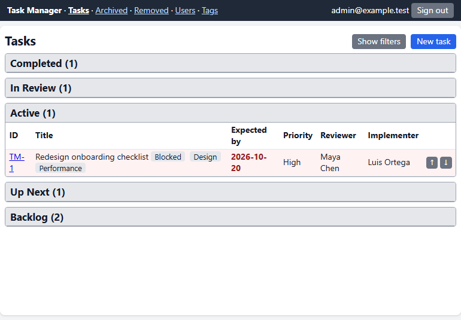
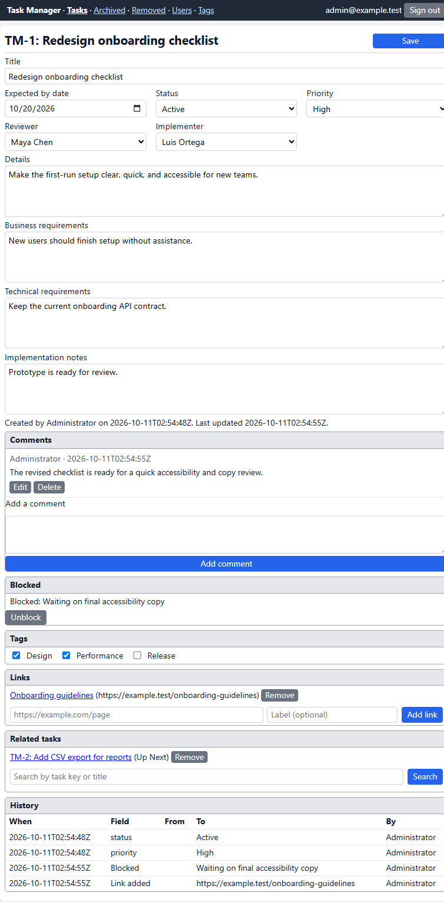
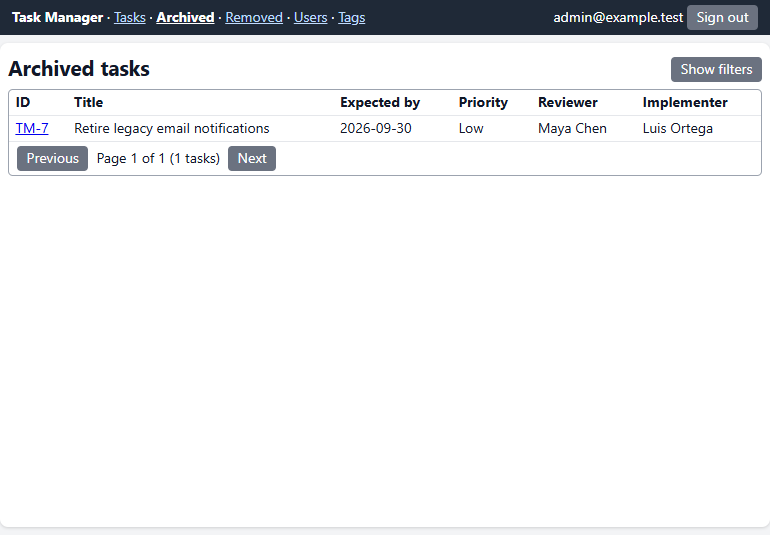
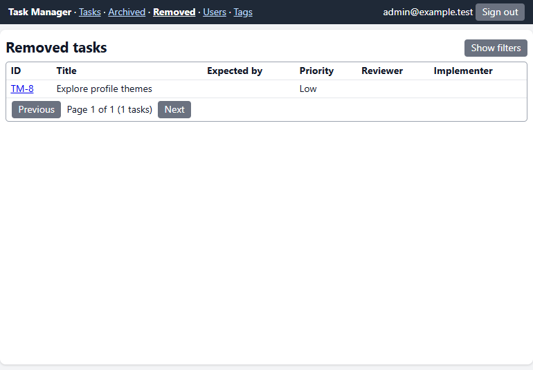
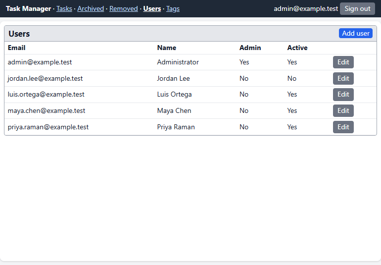
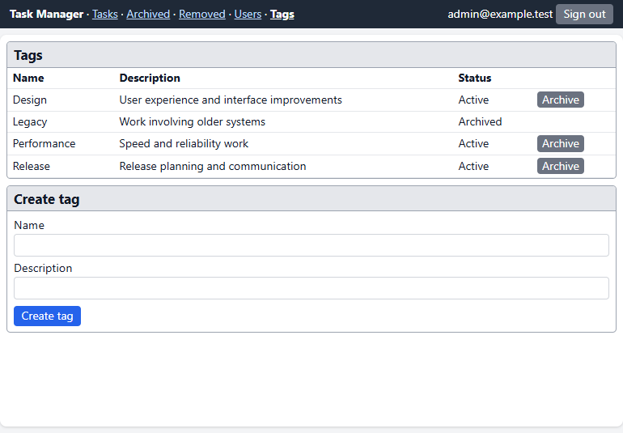

# Example page screenshots

These screenshots use fictional example records in an isolated local demo database. They are intended to illustrate the pages and their contents; they do not show production data.

## Task board

The board groups tasks by workflow status. Each task row shows its key, title, expected-by date, priority, reviewer, and implementer; tags and blocked tasks are marked inline. The active group is expanded in this example, while the other groups show their task counts. Search and filters are available from **Show filters**, and **New task** opens the task form.

## Task details

The task page combines editable fields (including the optional expected-by date, status, priority, and assignees) with supporting sections for comments, blocked status, tags, links, related tasks, and change history. This example has a high-priority task assigned to a reviewer and implementer, with a comment, a blocked reason, tags, a link, and a related task.

## Archived tasks

The archived view lists tasks that have been archived, with pagination and filters for task text, assignee, and tags. The example row shows the task key, title, expected-by date, priority, reviewer, and implementer.

## Removed tasks

The removed view provides a separate paginated list for tasks marked removed. It uses the same task columns and filtering controls as the archived view.

## Users

The users page shows email, display name, administrator status, and whether each account is active. Administrators can add users or open an existing account for editing.

## Tags

The tags page lists each tag's name, description, and active or archived state. Active tags can be archived from the list, and the form below it creates a tag.
